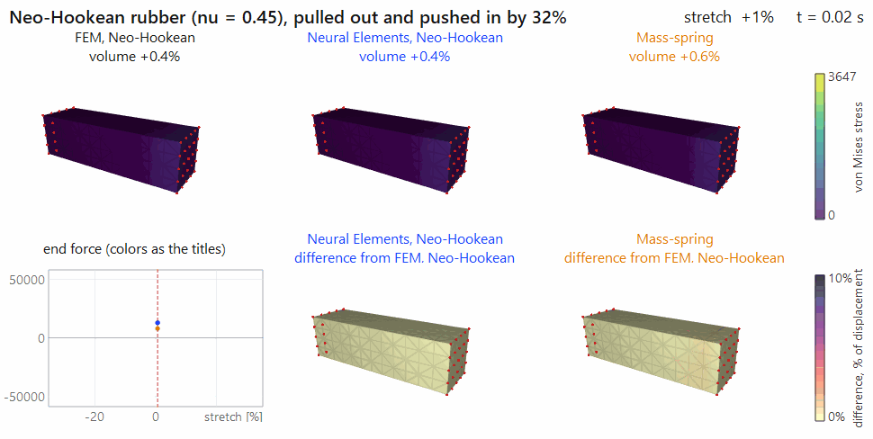
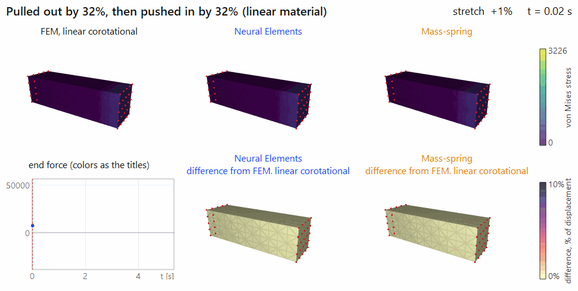
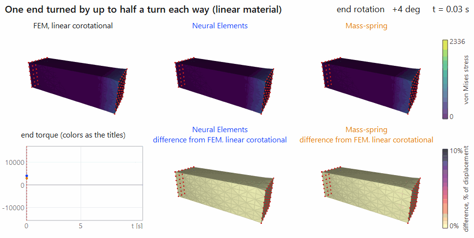
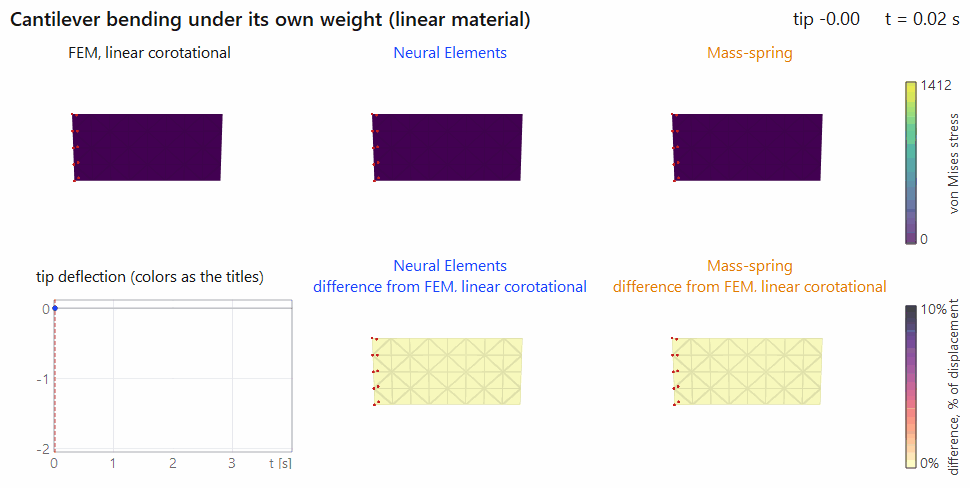
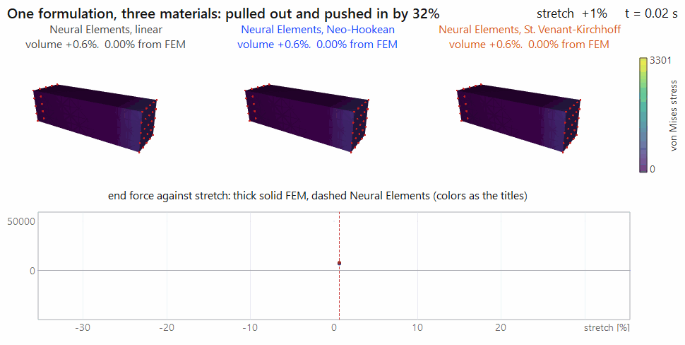

# Neural Elements

Neural Elements are finite elements whose internal forces are learned from a single reference element. A small
network is trained on the reaction forces of one regular tetrahedron under prescribed load cases. Each element of a
mesh then gets its forces from that network, transferred by the element's own geometry. No constitutive law is
evaluated at run time.

This shows that an element's internal representation can be a data-driven inverse process. The same element
formulation reproduces linear and nonlinear materials (Neo-Hookean, St. Venant-Kirchhoff); the only difference is the
data it was trained on.

The library is plain Python with PyTorch, and the same code runs on the CPU or on a CUDA GPU.

## Neural Elements, FEM and a mass-spring system

Each animation runs one scene with several force models side by side.
- **Top row:** the three models, colored by von Mises stress.
- **Bottom row:** the scene's main measurement (over time, or against stretch), and the position difference of the second and third model
  from the first. The difference scale is 0–10% of the first model's largest displacement.

**A nonlinear material.** The material is Neo-Hookean rubber (ν = 0.45), pulled out and pushed in by 32%. The plot
shows end force against stretch, which is the force curve of the material, and the titles show each model's volume.
- **Neural Elements** follow Neo-Hookean FEM: force within 0.8%, volume within 0.1 percentage points.
- **The mass-spring system** cannot represent the material:
  - too stiff in tension, where the peak force is 77% high;
  - too soft in compression, where the peak force is 35% low;
  - unable to keep the volume, which drops 25% against 5.6%, with elements inverting;
  - left dented after unloading.



**Compression.** One end is pulled out by 32%, then pushed in by 32%, with a linear material. In compression the
mass-spring system wrinkles and collapses: elements invert, and it loses 25% of its volume against FEM's 19%.
FEM and Neural Elements stay smooth and agree to 0.1%.



**Twist.** One end is turned by up to half a turn each way. The mass-spring system lags behind, and its peak torque is 18% low.



**Cantilever.** The beam bends under its own weight. The mass-spring system sags 9% less and swings faster.



**Neo-Hookean.** The same out-and-in cycle with a nonlinear material. Neural Elements, trained on Neo-Hookean
reference data, follow Neo-Hookean FEM, which softens in tension and stiffens in compression. Linear FEM does neither.


**Three materials, one formulation.** Linear, Neo-Hookean and St. Venant-Kirchhoff go through the same out-and-in
cycle. Each runs with Neural Elements (the nonlinear formulation with that material's network) and with that
material's FEM.
- **The materials diverge:** in tension St. Venant-Kirchhoff is the stiffest and Neo-Hookean the softest, and in
  compression it is the other way around. Their peak forces differ by up to 90%.
- **Neural Elements follow each material:** every dashed curve lies on its solid FEM curve, and the shapes stay within
  0.15% of their FEM.



The animations are made by `python examples/make_gifs.py`, in about 3 minutes, with the viewer's OpenGL renderer.

## Quick start

```
pip install -r requirements.txt
python example.py        # terminal example: the expected output, then the same simulations, row by row
python viewer.py         # interactive application (OpenGL)
python check.py          # self-checks: derivatives, model consistency, networks against FEM, GPU against CPU
```

`example.py` needs only `torch` and `numpy`. The viewer also needs `PyQt5` and `matplotlib`. The trained networks
are included in `models/`. On Windows, the `run_*.bat` files do the same; they use `python`, or the interpreter named
in the `PYTHON` environment variable.

## Minimal examples

`examples/` has one small script per material and scene: `linear-`, `neohookean-`, `stvk-` and `blend-`, combined
with `cantilever`, `stretch`, `compress` and `twist`, for example `examples/neohookean-compress.py`. Each script
builds the simulation and opens one 3D view that runs it in real time. The whole program is:

```python
from gui import show
from neural_elements import Material, Simulation

sim = Simulation("compress", model="ne_nonlinear", material=Material("neohookean"))
show(sim, title="Neo-Hookean material, compress")
```

In the view, the mouse rotates, pans and zooms, Space pauses and R restarts. Any of these scripts also takes
`--screenshot FILE --frames N`, which runs N frames without a window and saves the view.

## Layout

```
example.py               terminal example (no GUI)
viewer.py                interactive application
check.py                 self-checks
examples/                one script per material and scene (<material>-<scene>.py), and make_gifs.py (the
                         animations above -> examples/images/)
neural_elements/         the library
    materials.py         the material definition and the material models (linear, Neo-Hookean, St. Venant-Kirchhoff,
                         blend)
    linear.py            Neural Elements, linear formulation
    nonlinear.py         Neural Elements, nonlinear formulation
    fem.py               finite elements of every material model (the references)
    mass_spring.py       springs on the mesh edges
    training.py          training of both networks on the reference element
    solver.py            implicit Newmark, backward Euler, explicit Euler; matrix-free conjugate gradients
    scenes.py            beam meshes and the four test scenes
    simulation.py        scene + force model + integrator
    geometry.py          linear tetrahedra as element-wise tensor operations
gui/                     OpenGL renderer (GLSL shaders), the viewer's window, and show() for one view
training/                train_linear.py, train_nonlinear.py
models/                  trained networks: linear/linear.pt, nonlinear/{linear,neohookean,stvk,blend}.pt
```

## Using the library

```python
from neural_elements import Material, Simulation

sim = Simulation("stretch", model="ne_nonlinear", material=Material("neohookean"))
sim.run(sim.scene.loading_frames)               # pull the beam out to 32% strain
print(max(abs(f) for f in sim.history["force"]))

sim.set_material(E=12000, nu=0.4)               # live, per element if a mask is given; nothing is rebuilt
```

The force models are:
- `ne_nonlinear`: Neural Elements, nonlinear formulation;
- `ne_linear`: Neural Elements, linear formulation;
- `fem`: finite elements of the material;
- `mass_spring`.

The scenes are `cantilever`, `stretch`, `compress` and `twist`. A simulation takes `device="cuda"`, which runs in
single precision by default, and `refine=2..4` for 8 to 64 times the elements.

## Material definition

```python
Material(model="linear" | "neohookean" | "stvk" | "blend", E=..., nu=..., kappa=0.5)
```

| | role |
|---|---|
| `model` | which material, and so which trained network the Neural Elements use |
| `E` | Young's modulus. Forces scale with E, so it is not a network input; the networks work per unit E. |
| `nu` | Poisson's ratio, a network input (trained range 0–0.45) |
| `kappa` | for `blend` only: ψ = (1 − κ) ψ_linear + κ ψ_Neo-Hookean, one network input from linear (0) to Neo-Hookean (1) |

The material models:

| model | what it is | at large strain |
|---|---|---|
| `linear` | linear elasticity in each element's rotated frame, which is what linear corotational FEM computes | linear |
| `neohookean` | compressible Neo-Hookean, ψ = μ/2 (I1 − 3) − μ ln J + λ/2 (ln J)² | softens in tension, stiffens in compression |
| `stvk` | St. Venant-Kirchhoff: linear elasticity on the Green strain E = (FᵀF − I)/2, ψ = λ/2 (tr E)² + μ tr(E²) | stiffens in tension, softens in compression |
| `blend` | (1 − κ) linear + κ Neo-Hookean | in between |

Every model has the same small-strain behavior; they differ only at large strain.

St. Venant-Kirchhoff is meant for moderate compression. Past about 42% uniaxial compression it loses stiffness
altogether, and an element turned inside out has no energy pushing it back. The networks are trained on principal
stretches 0.65–1.45, inside its stable range.

The same material definition drives the FEM reference, so a Neural Element simulation can always be compared with the
FEM of its own material.

## The two formulations

**Linear formulation: single-node load cases.** This is the dissertation's formulation, optimized; see
`neural_elements/linear.py`.
- **Reference load case:** node A of the reference element is displaced by d along x. The network maps (ν, d) to the
  12 reaction forces per unit E (2-8-12, 132 weights).
- **Use in an element:**
  1. The element's rotation is taken out.
  2. Each of its 12 nodal displacements is answered by the network, at the displacement that gives the same strain
     in this element.
  3. The answer is reduced to its volumetric and shear parts on the reference element's two geometric stiffness bases.
  4. Those parts are applied to the element's own bases.
- **Exactness:** with exact linear data this is exactly linear corotational FEM.
- **Limitation:** a sum of single-node load cases cannot carry a nonlinear material, because the cross terms between
  the nodes are missing.

**Nonlinear formulation: one deformation load case, learned as an energy.** See `neural_elements/nonlinear.py`.
- **Reference load case:** the whole element deformation, all four nodes at once. The reaction forces are the gradient
  of the reference element's strain energy, so the network learns that energy W per unit E. Its inputs are ν, the
  material parameters, and the invariants of C = FᵀF (I1, I2, ln J). It has 96 weights, or 224 for the blend family.
- **Use in an element:** the stress P = ∂W/∂F comes from the network's own derivative and is transferred as
  f_i = V P ∇N_i. The transfer depends on geometry only and is exact for any element shape.
- **What C gives:**
  - C holds the six edge lengths, so no rotation is extracted;
  - the response is independent of orientation and direction by construction;
  - the tangent is the exact, symmetric second derivative;
  - the forces conserve energy.

Both networks are trained only on reaction forces of the reference element, never on forces from a simulation or test
scene. Training uses a relative-accuracy loss, so small strains are learned as well as large ones, and full-batch
L-BFGS.

## Training

```
python training/train_linear.py              # about 20 s
python training/train_nonlinear.py --all     # the four material models in parallel, about 10 min
python training/train_nonlinear.py --material neohookean
```

## Accuracy

Each Neural Element row is measured against the FEM of the same material (`example.py`):

| | FEM | NE, linear formulation | NE, nonlinear formulation |
|---|---|---|---|
| cantilever, linear material, tip deflection after 1 s | −1.9281 | −0.05% | −0.14% |
| stretch to 32%, linear material, peak force | 31542 | +0.03% | +0.36% |
| stretch to 32%, Neo-Hookean, peak force | 25739 | (linear only) | −0.06% |
| stretch to 32%, St. Venant-Kirchhoff, peak force | 48702 | (linear only) | +0.17% |
| stretch to 32%, blend κ = 0.5, peak force | 28695 | (linear only) | +0.15% |

In this stretch the materials differ by up to 89% (St. Venant-Kirchhoff against Neo-Hookean). A mass-spring system is 8.7% off in the cantilever.

Element forces of isolated elements from all scene meshes, under random rotations and stretches (`check.py`), are
within 0.09–0.29% (median) of the FEM of the same material at 1% and at 30% strain.

Over full runs of all four scenes, every combination of model and material converges every step with no inverted
elements. Peak loads are within 0.36% of the matching FEM.

## Performance

Time per frame on a laptop, where the scenes' time step is 1/60 s (twist: 1/30 s):

| | CPU, double precision | GPU, single precision | GPU, 64x the elements |
|---|---|---|---|
| elements | 640 – 2,520 | 640 – 2,520 | 40,960 – 161,280 |
| Neural Elements, nonlinear formulation | 18 – 33 ms | 8 – 17 ms | 26 – 104 ms |
| Neural Elements, linear formulation | 30 – 73 ms | 16 – 26 ms | 34 – 122 ms |
| FEM, Neo-Hookean | 9 – 19 ms | 7 – 10 ms | 24 – 82 ms |
| FEM, linear corotational | 30 – 68 ms | 11 – 20 ms | 28 – 101 ms |

The CPU is an Intel laptop CPU and the GPU an RTX 4080 Laptop.
- **The two linear models are the slowest.** They extract each element's rotation, and their tangent leaves the
  rotation out, so Newton's method needs more iterations.
- **The nonlinear formulation does neither.**
- **Small meshes:** at the default sizes the GPU is limited by kernel launches rather than arithmetic.
- **Precision:** GPU forces agree with the CPU's to about 1e-6.
