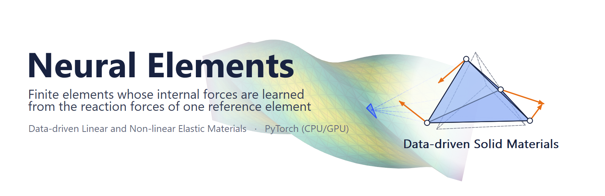

# Neural Elements

**TL;DR: data-driven continuum mechanics for solid elements.**
- **The material is the data.** The same formulation reproduces linear, Neo-Hookean and St. Venant-Kirchhoff
  materials to within 0.4% of finite elements (FEM). Only the training data changes.
- **Real-time simulation in plain PyTorch.** The scenes here, up to 2,520 elements, run in real time on a laptop GPU.
  The same code runs on the CPU and scales to 161k elements. It comes with an OpenGL viewer and one-file examples.
- **One reference element.** A small network (96 weights) learns the reaction forces of one reference tetrahedron.
  Every element of a mesh gets its internal forces from it, through its own geometry. No constitutive law is
  evaluated at run time.

## The approach

In the finite element method, an element's internal forces come from a constitutive law evaluated at its integration
points. A Neural Element is defined by measurements instead: by how a *reference element* responds when it is
deformed.

1. **Reference element.** A regular tetrahedron is given load cases: prescribed displacements of its nodes. What is
   recorded is its nodal reaction forces. They can come from any source that can deform one element: a material
   model, a finer simulation, or a test.
2. **Learning.** A small network maps the load case, Poisson's ratio and any material parameters to those reaction
   forces, per unit Young's modulus.
3. **Transfer.** Each element of a mesh poses its own deformation to the reference element as a load case. The
   network's answer is carried back to the element by the element's geometry.

The element's internal representation therefore becomes a data-driven inverse process: a learned map from
deformation to reaction forces. There are two formulations.
- **Linear.** Twelve single-node load cases per element, the formulation of the original Neural Elements work
  ([dissertation](#citation)). It covers linear materials.
- **Nonlinear.** One load case per element, its whole deformation. The network learns the reference element's strain
  energy, and the forces are its derivative. This carries nonlinear materials. It needs no rotation extraction, its
  tangent is exact and symmetric, and its forces conserve energy.

## Features

- **Neural Elements:** both formulations, with trained networks for every material in `models/`.
- **Materials:**
  - linear (corotational), Neo-Hookean and St. Venant-Kirchhoff;
  - a linear-to-Neo-Hookean blend whose blend parameter κ is a network input;
  - E, ν and κ set per element and changed while the simulation runs.
- **References:** FEM for every material, and a mass-spring system for contrast.
- **Training:** data generation on the reference element and full-batch L-BFGS scripts. A network trains in seconds
  (linear) to minutes (nonlinear) on a laptop.
- **Simulation:**
  - implicit Newmark, backward Euler and explicit Euler;
  - matrix-free conjugate gradients;
  - CPU in double precision or CUDA in single precision;
  - four scenes: cantilever, stretch, compress, twist.
- **Tools:**
  - `example.py`, a terminal example that prints its expected output;
  - `check.py`, self-checks;
  - `viewer.py`, an OpenGL application;
  - `show()`, a single 3D view for scripts;
  - 16 one-file examples, and the scripts that make the images on this page.

## Dependencies

| package | tested with | needed for |
|---|---|---|
| Python | 3.11 | everything |
| PyTorch | 2.11 (requirements: 2.0 or newer); CUDA 13.0 optional | the library |
| NumPy | 2.4 | the library |
| PyQt5 | 5.15 | the viewer, `show()` and the images |
| Matplotlib | 3.10 | color maps |
| Pillow | 12.1 (installed with Matplotlib) | writing GIFs |

The viewer needs a graphics driver with OpenGL 4.1. A CUDA GPU is optional.

## Quick start

```
pip install -r requirements.txt
python example.py                       # terminal: expected output, then the same simulations (about 40 s)
python viewer.py                        # interactive application
python examples/neohookean-compress.py  # one material, one scene, one view
python check.py                         # self-checks
```

`example.py` needs only PyTorch and NumPy.

## Results

**Twist.** One end of a beam is turned by up to half a turn each way, with a linear material. The scene runs with FEM,
Neural Elements and a mass-spring system.
- **Top row:** each model, colored by von Mises stress.
- **Bottom row:** the end torque, and the position difference from FEM, on a scale of 0–10% of FEM's largest
  displacement.

Neural Elements stay within 0.2% of FEM. The mass-spring system lags behind, and its peak torque is 18% low.


**One formulation, three materials.** Linear, Neo-Hookean and St. Venant-Kirchhoff are pulled out and pushed in by
32%. Each runs with Neural Elements, using that material's network, and with the material's FEM.
- **The materials diverge.** In tension St. Venant-Kirchhoff is the stiffest and Neo-Hookean the softest; in
  compression it is the other way around.
- **Neural Elements follow each one.** Every dashed curve lies on its FEM curve.


**Nonlinear against linear.** Neural Elements trained on Neo-Hookean data follow Neo-Hookean FEM. Linear FEM misses
both the softening in tension and the stiffening in compression.


### Comparison with FEM and a mass-spring system

The remaining scenes use the same layout as the twist.

**Neo-Hookean rubber (ν = 0.45), out and in by 32%.** Neural Elements match Neo-Hookean FEM to 0.8% in force and 0.1
percentage points in volume. The springs get the material wrong:
- 77% too stiff in tension;
- 35% too soft in compression;
- losing 25% of the volume, where the rubber loses 5.6%.


**Linear material, out and in by 32%.** In compression the mass-spring system wrinkles and elements invert. FEM and
Neural Elements agree to 0.1%.


**Cantilever.** The beam bends under its own weight. The mass-spring system sags 9% less and swings faster. Neural
Elements stay within 0.2% of FEM.


## Using the library

```python
from neural_elements import Material, Simulation

sim = Simulation("stretch", model="ne_nonlinear", material=Material("neohookean"))
sim.run(sim.scene.loading_frames)                     # pull the beam out to 32%
print(max(abs(f) for f in sim.history["force"]))
sim.set_material(E=12000, nu=0.4)                     # live, per element with a mask
```

- **Force models:** `ne_nonlinear`, `ne_linear` (linear material only), `fem` and `mass_spring`.
- **Scenes:** `cantilever`, `stretch`, `compress` and `twist`.
- **Options:** `device="cuda"` runs in single precision; `refine=2..4` gives 8–64 times the elements.

```python
Material(model="linear" | "neohookean" | "stvk" | "blend", E=..., nu=..., kappa=0.5)
```

| model | material | at large strain |
|---|---|---|
| `linear` | linear elasticity in each element's rotated frame (what linear corotational FEM computes) | linear |
| `neohookean` | compressible Neo-Hookean, ψ = μ/2 (I1 − 3) − μ ln J + λ/2 (ln J)² | softens in tension, stiffens in compression |
| `stvk` | St. Venant-Kirchhoff, ψ = λ/2 (tr E)² + μ tr(E²), E = (FᵀF − I)/2 | stiffens in tension, softens in compression |
| `blend` | (1 − κ) linear + κ Neo-Hookean | in between |

How the material values are handled:
- **E** scales the forces; the networks work per unit E.
- **ν** is a network input, trained over 0–0.45.
- **κ** is a network input of the blend.
- **Small strain:** every model behaves the same there.

St. Venant-Kirchhoff is meant for moderate compression. The networks are trained on principal stretches 0.65–1.45.

Each script in `examples/` is the minimal program for one material and scene:

```python
from gui import show
from neural_elements import Material, Simulation

show(Simulation("compress", model="ne_nonlinear", material=Material("neohookean")))
```

## Training

```
python training/train_linear.py                       # about 20 s
python training/train_nonlinear.py --all              # the four material models in parallel, about 10 min
python training/train_nonlinear.py --material stvk    # one material model
```

The targets are reaction forces of the reference element only, never forces from a simulation. The loss counts
each load case's error relative to its size, so small strains are learned as well as large ones.

## Accuracy and performance

Each value is against the FEM of the same material; the first three rows come from `example.py`, the fourth from
`check.py`.

| | NE linear formulation | NE nonlinear formulation |
|---|---|---|
| cantilever tip after 1 s, linear material | −0.05% | −0.14% |
| peak force at 32% stretch: linear | +0.03% | +0.36% |
| peak force at 32% stretch: Neo-Hookean, St. Venant-Kirchhoff, blend | — | −0.06%, +0.17%, +0.15% |
| element forces at 1–30% strain, random rotations (median) | 0.18% | 0.09–0.29% |

Over full runs of every scene, all models converge at every step and no element inverts.

Time per frame on a laptop, against the scenes' time step of 16.7 ms (twist: 33 ms):

| | CPU, double | GPU, single | GPU, 64x elements |
|---|---|---|---|
| elements | 640 – 2,520 | 640 – 2,520 | 40,960 – 161,280 |
| NE, nonlinear formulation | 18 – 33 ms | 8 – 17 ms | 26 – 104 ms |
| NE, linear formulation | 30 – 73 ms | 16 – 26 ms | 34 – 122 ms |
| FEM, Neo-Hookean | 9 – 19 ms | 7 – 10 ms | 24 – 82 ms |

## Layout

```
neural_elements/   the library: materials, linear and nonlinear formulations, FEM, mass-spring, training, solver,
                   scenes, simulation, geometry
models/            trained networks: linear/linear.pt, nonlinear/{linear,neohookean,stvk,blend}.pt
training/          training scripts
gui/               OpenGL renderer (GLSL shaders), the viewer's window, show()
examples/          <material>-<scene>.py, make_gifs.py and make_title.py (the images on this page)
example.py         terminal example
viewer.py          interactive application
check.py           self-checks
```

## Citation

Neural Elements were introduced in Chapters 2 and 3 of this dissertation. This library ports that work to Python and
extends it with the nonlinear formulation and the material models above.

Shane Transue. [*Inverse Modeling for Data-driven Physical Simulation*](https://digital.auraria.edu/works/publication-dissertation/czp2s-8h211). Doctoral dissertation, Department
of Computer Science and Engineering, University of Colorado Denver, 2019.

```bibtex
@phdthesis{transue2019inverse,
  author  = {Shane Transue},
  title   = {Inverse Modeling for Data-driven Physical Simulation},
  school  = {University of Colorado Denver, Department of Computer Science and Engineering},
  address = {Denver, Colorado},
  year    = {2019},
  type    = {Doctoral dissertation},
  url     = {https://digital.auraria.edu/works/publication-dissertation/czp2s-8h211}
}
```

## License

MIT, see [LICENSE](LICENSE). The trained networks and the images are covered by the same license.
